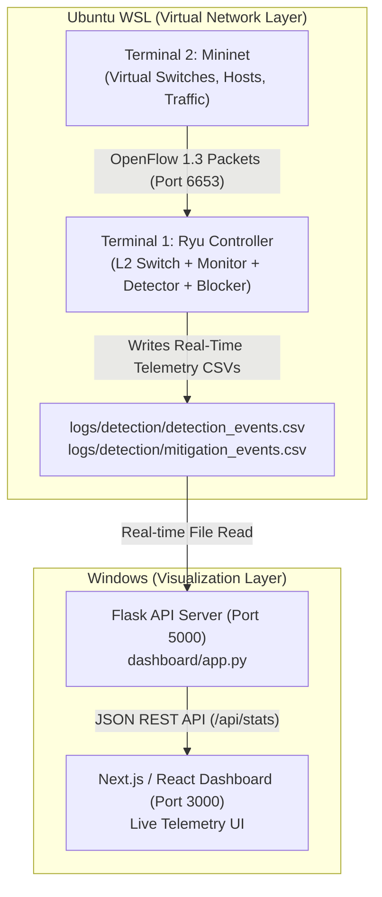

# 🛡️ SDN DDoS Detection & Mitigation System — Complete Startup & Architecture Guide

This document explains **how the system works**, **what each terminal does in plain English**, and provides a **1-click startup cheatsheet** for quick execution anytime.

---

## 🧠 Part 1: What Are the 2 Ubuntu Terminals For? (Simple Plain-English Explanation)

To understand why we need 2 Ubuntu terminals, think of an SDN (Software-Defined Network) like an **Air Traffic Control System**:

### ✈️ Real-World Analogy:
* **Terminal 1 (Ryu Controller)** is the **Air Traffic Control Tower (The Brain)**.
* **Terminal 2 (Mininet)** is the **Airspace with Planes Flying Around (The Physical World)**.

---

### 🖥️ Terminal 1: The Ryu SDN Controller (`start_controller.sh`)
* **What is it?**  
  It is the **central brain** of your Software-Defined Network. In traditional networks, switches make routing decisions by themselves. In SDN, the switches are "dumb" hardware, and the Ryu controller tells them how to forward every single packet.
* **What does it do while running?**
  1. **Directs Traffic:** Listens on port `6653` using the **OpenFlow 1.3** protocol to manage virtual switches `s1` and `s2`.
  2. **Watches Telemetry:** Every 1 second, it queries the switches: *"How many packets passed through port X? How many bytes went to server1?"*
  3. **Detects Attacks:** Analyzes the incoming stats using a statistical Z-Score algorithm. If packet arrival rates spike beyond normal limits and persist for multiple intervals, it flags: **`DDOS_DETECTED`**!
  4. **Neutralizes Threats:** The moment an attack is detected, it pushes a high-priority OpenFlow `DROP` rule directly into the switch hardware, instantly blocking the attacker's MAC address (`00:00:00:00:00:a1`).
* **Why does it need its own terminal?**  
  Ryu is a continuous server process. It never shuts down on its own; it runs 24/7 listening for network events. If you ran anything else in that same terminal, Ryu would have to be stopped.

---

### 🌐 Terminal 2: Mininet Simulation (`run_simulation.sh`)
* **What is it?**  
  It is the **virtual network simulator**. Since we do not have 6 physical computers and 2 expensive hardware network switches lying on our desk, Mininet creates virtual network namespaces inside Linux that behave exactly like real Linux machines and real Ethernet cables.
* **What does it do while running?**
  1. **Builds the Network Topology:**
     * Switch **`s1`**: Connected to legitimate users (`client1`, `client2`, `client3`).
     * Switch **`s2`**: Connected to attackers (`attacker1`, `attacker2`) and the target web server (`server1`).
     * Trunk Link: Connects `s1` $\leftrightarrow$ `s2`.
  2. **Connects to Terminal 1:** It connects the virtual switches `s1` and `s2` to the Ryu controller waiting on port `6653`.
  3. **Generates Normal Traffic:** Starts an HTTP server on `server1` (`10.0.0.200:80`) and simulates legitimate clients sending web requests (`curl`) for 15 seconds to let the detector learn the baseline.
  4. **Launches the Attack:** Commands `attacker1` to launch a high-speed TCP SYN Flood (`hping3 --flood`) targeting `server1`.
* **Why does it need its own terminal?**  
  Mininet needs to interactively start switches, run ping tests, launch `hping3`, and show traffic output. It connects to Ryu as an external client.

---

## 🔄 How the 4 Components Fit Together



1. **Mininet (Terminal 2)** generates network packets.
2. **Ryu (Terminal 1)** monitors the traffic, detects attacks, and blocks the attacker.
3. **Ryu** logs all statistics into `logs/detection/detection_events.csv`.
4. **Flask (Windows port 5000)** reads those logs and serves JSON via REST API.
5. **Next.js (Windows port 3000)** polls the API every second and renders live telemetry graphs and alerts on your screen.

---

## ⚡ 1-Click Startup Guide (Anytime You Start Your PC)

Whenever you restart your PC or want to demo the project, follow these simple steps:

### Step 1: Start Windows Backend & Frontend (Run in Windows VS Code / PowerShell)
Both are already running in your background! If you ever need to restart them:

```powershell
# In Windows Terminal (Tab 1) - Flask API:
cd "E:\College\CN\CN_Project\SDN-DDoS-Detection-and-Mitigation-main\SDN-DDoS-Detection-and-Mitigation-main"
python dashboard/app.py

# In Windows Terminal (Tab 2) - Next.js UI:
cd "E:\College\CN\CN_Project\SDN-DDoS-Detection-and-Mitigation-main\SDN-DDoS-Detection-and-Mitigation-main\frontend"
npm run dev
```
Open in browser: 👉 **http://localhost:3000**

---

### Step 2: Start Ryu SDN Controller (Ubuntu WSL — Terminal 1)
Open your first Ubuntu terminal and simply run:

```bash
cd /mnt/e/College/CN/CN_Project/SDN-DDoS-Detection-and-Mitigation-main/SDN-DDoS-Detection-and-Mitigation-main
bash start_controller.sh
```
*(Leave this running — it will show all 4 Ryu modules initializing)*

---

### Step 3: Run the Attack Simulation (Ubuntu WSL — Terminal 2)
Open your second Ubuntu terminal and simply run:

```bash
cd /mnt/e/College/CN/CN_Project/SDN-DDoS-Detection-and-Mitigation-main/SDN-DDoS-Detection-and-Mitigation-main
bash run_simulation.sh
```

---

## 🛠️ Quick Troubleshooting Cheatsheet

| Issue | Cause | Solution |
| :--- | :--- | :--- |
| **`Address already in use: 5000`** | Stale Python process holding port 5000 | In PowerShell: `Get-Process python \| Stop-Process -Force` |
| **`Cannot find switch s1` / Mininet error** | Previous Mininet run didn't exit cleanly | Run: `sudo mn -c` |
| **`ryu-manager: command not found`** | Virtual environment not active | Run: `source ~/ryu-env/bin/activate` |
| **Frontend shows "API OFFLINE"** | Flask backend isn't running | Run `python dashboard/app.py` in Windows |
